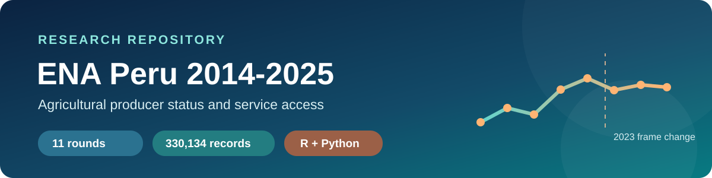
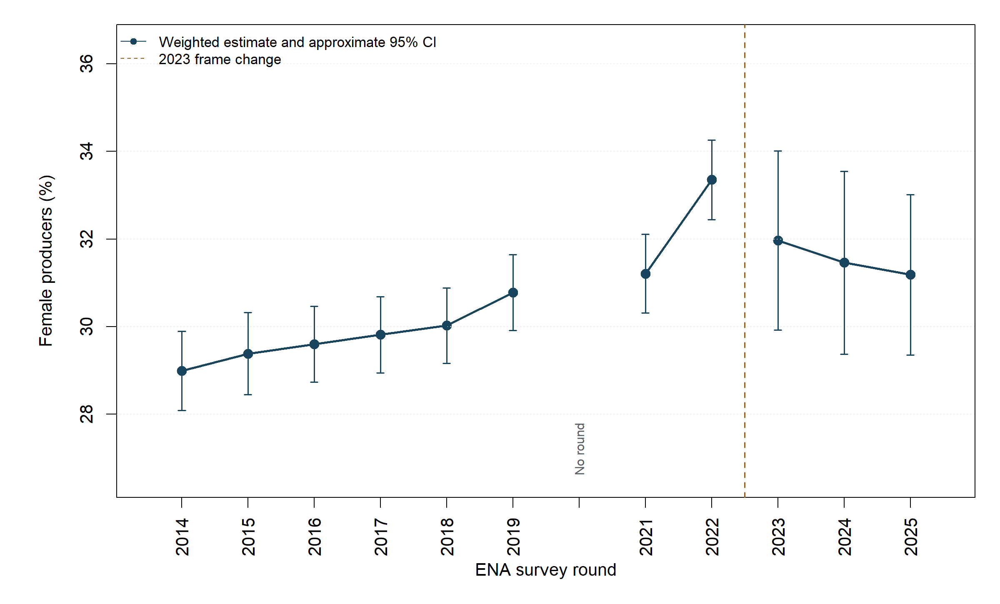
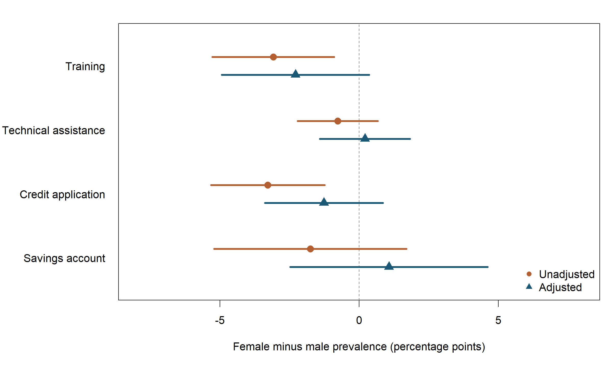

# Productoras agropecuarias en Perú | ENA 2014-2025

**Manuscrito y paquete de análisis reproducible** sobre el sexo registrado de la persona productora en once rondas de la Encuesta Nacional Agropecuaria (ENA), más un análisis independiente del acceso a servicios en 2025.

📄 [Artículo](manuscript.pdf) · 🧾 [LaTeX](manuscript.tex) · 📦 [Zenodo 3.0.0](https://doi.org/10.5281/zenodo.24395430) · 📋 [Ficha del modelo](MODEL_CARD.md) · 📚 [Cómo citar](CITATION.cff)

> **Estado de reproducibilidad.** El PDF puede recompilarse con este repositorio. Los análisis pueden volver a ejecutarse con los módulos oficiales ENA 2025 y el consolidado `ENA_2014_2024.sav` usado por el proyecto. **No hay una receta verificada para reconstruir ese consolidado desde todos los módulos anuales originales**; la reproducción completa desde datos brutos de 2014-2024 sigue pendiente.

## El estudio de un vistazo

| Alcance | Resultado descriptivo | Precaución |
| :--- | :--- | :--- |
| **11 rondas**: 2014-2019 y 2021-2025 | **330.134** registros analíticos | No hubo ronda ENA en 2020. |
| Sexo registrado | **28,99 %** de productoras en 2014 y **31,18 %** en 2025, con ponderación anual | El marco muestral cambió alrededor de 2023. |
| Acceso en 2025 | Capacitación: **5,28 %** de productoras y **8,37 %** de productores | Asociación descriptiva, no efecto causal. |
| Validación temporal | AUC ponderada **0,615** en la ronda 2025 | Desempeño insuficiente para decisiones individuales. |

### Serie 2014-2025



*Los intervalos son aproximados. El cambio de marco de 2023 limita la comparación entre extremos. Fuente: cálculos del proyecto con ENA.*

### Acceso a servicios en 2025



*Diferencias en puntos porcentuales, antes y después del ajuste del manuscrito. Fuente: cálculos del proyecto con ENA 2025.*

## Contenido

| Ruta | Función |
| :--- | :--- |
| [`manuscript.pdf`](manuscript.pdf), [`manuscript.tex`](manuscript.tex) | Artículo y fuente editable; cinco figuras y 33 referencias citadas. |
| [`scripts_historical/`](scripts_historical/) | Extracción y modelado de la serie 2014-2025. |
| [`supplementary_analysis.R`](supplementary_analysis.R) | Intervalos, estandarización y calibración temporal. |
| [`build_2025_access.py`](build_2025_access.py), [`analyse_2025_access.R`](analyse_2025_access.R), [`make_2025_figures.R`](make_2025_figures.R) | Unión de módulos, análisis y figuras de acceso en 2025. |
| [`results_historical/`](results_historical/), [`results_2025/`](results_2025/) y `supplementary_*.csv` | Resultados agregados y `sessionInfo` de las ejecuciones verificadas. |
| [`source_hashes.csv`](source_hashes.csv), [`source_manifest.csv`](source_manifest.csv), [`PACKAGE_MANIFEST_SHA256.csv`](PACKAGE_MANIFEST_SHA256.csv) | Tamaños y SHA-256 de entradas y entregables. |
| [`verify_package.py`](verify_package.py) | Comprueba integridad del paquete y, opcionalmente, de los archivos ENA locales. |

No se publican microdatos individuales ni extractos intermedios `LOCAL_ONLY.csv`.

## Reproducir los resultados

### 1. Conseguir y verificar las entradas

Descargue los cuatro módulos oficiales de **ENA 2025** desde el [Portal de Microdatos del INEI](https://proyectos.inei.gob.pe/microdatos/): `19_CAP1100.sav`, `15_CAP700.sav`, `17_CAP900.sav` y `01_CAP100A_01.sav`. Para la serie histórica se requiere además el consolidado local `ENA_2014_2024.sav` usado por el proyecto. Este último pesa **14,75 GB**, no está incluido y carece de una receta de construcción validada desde los módulos originales.

El verificador usa solo la biblioteca estándar de Python. La comprobación SHA-256 del consolidado grande puede tardar varios minutos.

```powershell
python verify_package.py
python verify_package.py --historical "D:\datos\ENA_2014_2024.sav" --ena-2025-root "D:\datos\ENA_2025"
```

Los hashes esperados están en [`source_hashes.csv`](source_hashes.csv) y [`source_manifest.csv`](source_manifest.csv). Si las entradas difieren, no se garantizan los mismos resultados numéricos.

### 2. Preparar el entorno

La ejecución verificada utilizó **Python 3.12**, `pandas==3.0.1`, `pyreadstat==1.3.8`, **R 4.5.2** y `survey 4.5` en Windows 11. Las demás versiones R están registradas en [`results_historical/sessionInfo.txt`](results_historical/sessionInfo.txt) y [`results_2025/sessionInfo.txt`](results_2025/sessionInfo.txt). Se necesita `pdflatex` para reconstruir el PDF.

```powershell
python -m pip install -r requirements.txt
Rscript -e 'install.packages("survey", repos="https://cloud.r-project.org")'
```

El instalador opcional [`scripts_historical/setup.ps1`](scripts_historical/setup.ps1) guarda dependencias en `.deps/`. Compruebe la versión de `survey` instalada si desea igualar el entorno documentado.

### 3. Ejecutar desde la raíz del repositorio

Cambie las rutas iniciales por sus archivos locales. Mantenga `$privado` **fuera del repositorio**: los CSV intermedios contienen microdatos.

```powershell
$historico = "D:\datos\ENA_2014_2024.sav"
$ena2025 = "D:\datos\ENA_2025"
$cap1100 = "D:\datos\ENA_2025\1036-Modulo1911\19_CAP1100.sav"
$privado = "D:\ena_resultados_privados"
New-Item -ItemType Directory -Force -Path $privado | Out-Null

python scripts_historical/extract_design.py --historical $historico --round-2025 $cap1100 --output "$privado\holders_2014_2025_LOCAL_ONLY.csv"
Rscript scripts_historical/run_analysis.R "$privado\holders_2014_2025_LOCAL_ONLY.csv" "$privado\historico"
Rscript supplementary_analysis.R "$privado\holders_2014_2025_LOCAL_ONLY.csv" "$privado\suplementos"

python build_2025_access.py --ena-root $ena2025 --output "$privado\ena_2025_access_LOCAL_ONLY.csv"
Rscript analyse_2025_access.R "$privado\ena_2025_access_LOCAL_ONLY.csv" "$privado\acceso_2025"
Rscript make_2025_figures.R "$privado\acceso_2025"
```

Compare las tablas agregadas generadas con [`results_historical/`](results_historical/), [`results_2025/`](results_2025/) y los archivos `supplementary_*.csv`. Los metadatos de sesión y las imágenes pueden variar entre sistemas. Las figuras publicadas se incluyen para compilar el PDF sin microdatos:

```powershell
pdflatex -interaction=nonstopmode -halt-on-error manuscript.tex
pdflatex -interaction=nonstopmode -halt-on-error manuscript.tex
```

## Interpretación y límites

- Cada estimación anual se refiere a la población objetivo de su ronda. El cambio de marco alrededor de 2023 impide tratar 2014 y 2025 como una tendencia estrictamente comparable.
- Los intervalos históricos usan una aproximación de estratos año-departamento. Los de acceso 2025 usan estratos registrados y un ajuste para estratos con un solo conglomerado. Ninguno es un intervalo oficial del INEI.
- El código binario de sexo registrado de la persona productora no mide identidad de género, propiedad legal, trabajo, autonomía ni discriminación.
- Las asociaciones de servicios y crédito no establecen causalidad. Consulte [`MODEL_CARD.md`](MODEL_CARD.md) para conocer el uso y la validación del modelo.

## Cita, licencia y envío a revista

Cite la [versión 3.0.0 archivada en Zenodo](https://doi.org/10.5281/zenodo.24395430) y consulte [`CITATION.cff`](CITATION.cff). El material original del proyecto se distribuye bajo [CC BY 4.0](LICENSE.md); los microdatos oficiales no están redistribuidos aquí.

Antes del envío a revista, los autores deben completar afiliaciones, correspondencia, contribuciones, financiación, conflictos de interés y la determinación ética institucional. Véase [`SUBMISSION_READINESS.md`](SUBMISSION_READINESS.md).
